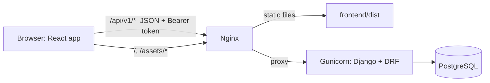
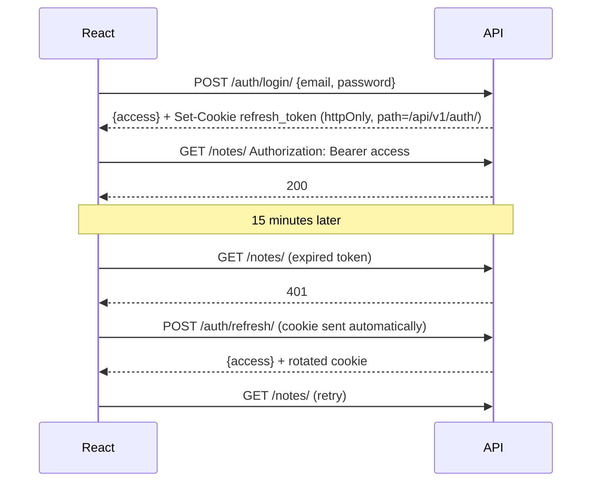

# Architecture

## The big picture



- **Same origin:** in production, Nginx serves the React build and passes `/api/` and `/admin/` to Django. In development, Vite forwards `/api/` to Django. Either way, the browser sees one origin, so there's no CORS setup and the refresh cookie just works.
- **Separate frontend:** React only talks to Django through the JSON API, so a mobile app could use the same API later.

## Backend layers

Each feature app follows the same layers:

```text
HTTP request
  -> urls.py         route to a view
  -> views.py        HTTP only: permissions, parse input, call a service, return a response
  -> serializers.py  validate input, shape output
  -> services.py     business rules and selectors, with no HTTP objects
  -> models.py       tables and simple model methods
```

**Why services:** the same rule can then be reused by an API view, an admin action, a management command or a background job, and tested without HTTP.

## Login flow



| Token | Where it lives | Lifetime | Why |
|---|---|---|---|
| Access | React memory only | 15 min | Scripts injected into the page can't find it in storage, and a leaked token expires soon |
| Refresh | httpOnly, SameSite=Lax cookie on `/api/v1/auth/` | 7 days, rotated on use | JavaScript can't read it, and it's only sent to the auth endpoints |

Logout blacklists the refresh token. A reused old refresh token is rejected. More detail is in `adr/0002-auth-tokens.md`.

## Settings

| File | Used by | Key points |
|---|---|---|
| `base.py` | Everything | Apps, DRF, JWT and logging, with values read from the environment |
| `dev.py` | `manage.py` (default) | DEBUG on and a placeholder secret |
| `test.py` | pytest | In-memory DB, fast hashing, no throttling |
| `prod.py` | Gunicorn (default in `wsgi.py`) | Refuses to start without a secret and hosts, sets HTTPS headers, JSON-only API |

## Frontend structure

- `api/client.js` holds the access token, refreshes on 401, and turns errors into `ApiError` with `status`, `code`, `message` and `details`.
- `features/auth/` has the `AuthProvider`. On page load it tries a refresh, so a valid cookie logs you straight back in.
- Each `features/<name>/` folder owns its API calls, pages and components.
- `app/App.jsx` is the single route table.

## Security baseline

- **Login required by default:** apps opt out per view.
- **Ownership:** querysets are filtered by owner, and `IsOwner` checks each object as well.
- **Passwords:** 10+ characters, checked against common and similar passwords, and hashed with PBKDF2.
- **Throttling:** login, register and refresh share a 10/min limit, with general limits for everyone else.
- **Production:** HTTPS redirect, HSTS, secure cookies, nosniff, frame denial and referrer policy. `check --deploy` runs in CI.
- **Secrets:** only in `.env` on the server, which is git-ignored, and pre-commit detects private keys.
- **Admin:** served at `/admin/`. Restrict it by IP in Nginx for internet-facing projects.
